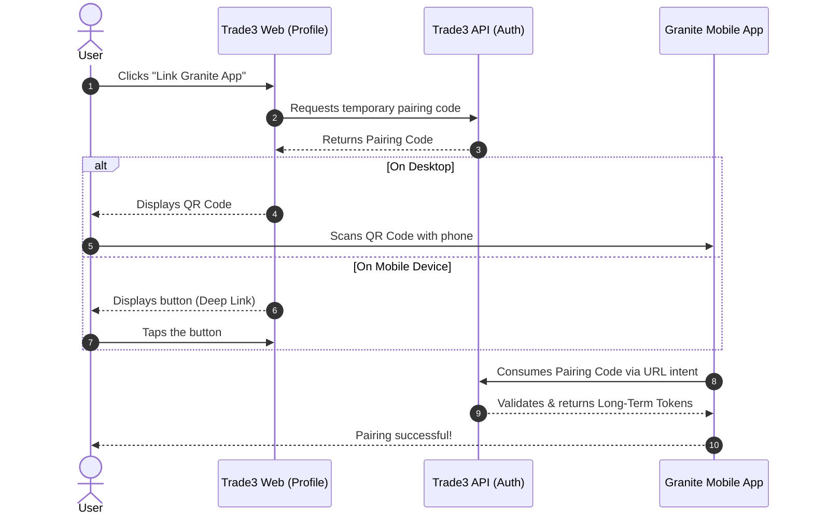
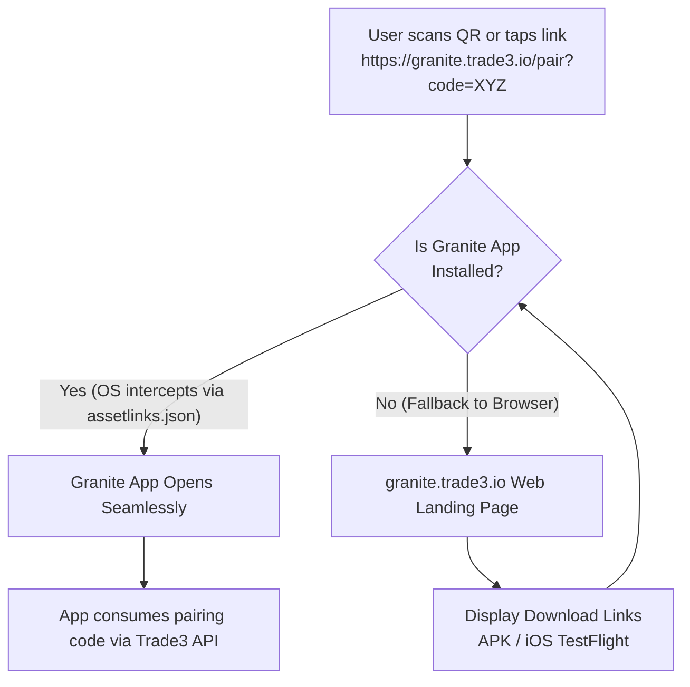
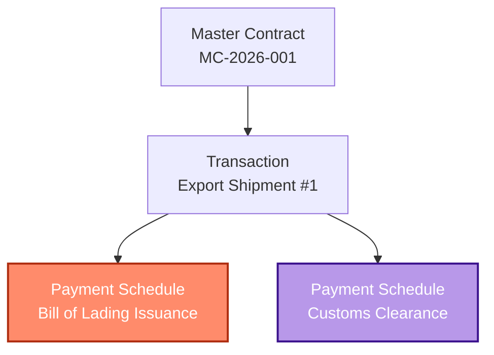

# Trade3 Granite — Architecture & Mobile Pairing Migration

This document outlines the logical architecture, business flows, and technical impacts associated with integrating the **Trade3 Granite** mobile attestation app into the broader Trade3 web ecosystem.

The primary objective is to enable users to seamlessly link their web account to their mobile application. This integration allows them to capture and attest physical documents (photos or files) directly tied to their on-chain contracts in any context they choose.

---

## 1. The Pairing Logic (Authentication Flow)

Initially, several pairing methods were explored. A traditional "Connect with Trade3" approach would have functioned but was deemed too heavy for development and caused too much friction for the user (requiring them to log in again on the mobile app). Therefore, after evaluation, a **Translucent Pairing Code via Deep Link** was selected as the optimal solution.

### User Experience Flow

1. **From the Web (Desktop):** The user accesses their profile page and clicks the "Link Granite App" button, which displays a **QR Code** pointing to `granite.trade3.io`.
2. **From the Web (Mobile):** The user accesses their profile page and clicks the "Link Granite App" button, acting as a direct hypertext link.
3. **The Deep Link Routing:** Both the QR code and the link contain an abstract pairing code (transparent to the user). The server at `granite.trade3.io` is already configured and tested to handle this:
   * **If the Granite app is installed:** The OS automatically intercepts the link and opens the application on the phone (currently functional on Android, planned for iOS).
   * **If the app is NOT installed:** The user is prompted to install the APK.
   > ⚠️ **Note:** Currently, no iOS version of the application has been developed.
4. **Continuous Authentication:** Once in the mobile app, the code is automatically consumed to link the device to the Granite account. This consumption links the two entities via a refreshable authentication token, valid for at least 6 months (and remotely modifiable or revocable).

### Pairing Sequence Diagram



#### 🔗 Deep Link Routing Logic (`granite.trade3.io`)

The pairing process relies on a translucent deep link mechanism (`https://granite.trade3.io/pair?code=XYZ`) that abstracts the authentication complexity from the user. This single URL intelligently adapts its behavior based on the user's device and app installation status.

*   **Native Interception (App Installed):** If the Trade3 Granite app is installed on the device, the mobile operating system (validated via Android App Links and `assetlinks.json`) automatically intercepts the URL. The app opens seamlessly, bypasses the browser entirely, and securely consumes the abstract pairing code to issue the session tokens.
*   **Browser Fallback (App Not Installed):** If the app is missing, the OS naturally defaults to opening the URL in the mobile web browser. The user is then presented with a dedicated landing page offering direct installation options (Native APK download, and eventually iOS TestFlight).



---

## 2. Business Hierarchy Synchronization

Once paired, the mobile app will fetch the configuration of the user's projects to offer them the choice to take photos or verify documents via Granite within any specific context.

### Hierarchy Structure



*(The mobile UI will grey out "completed" Payment Schedules and highlight those "active").*

### JSON Payload Example

```json
{
  "status": "success",
  "data": {
    "master_contracts": [
      {
        "id": "mc_01HFW...",
        "title": "Master Contract - Alpha Trading",
        "reference": "MC-2026-001",
        "transactions": [
          {
            "id": "tx_01HFX...",
            "title": "Export Shipment #1",
            "payment_schedules": [
              {
                "id": "ps_01HFY...",
                "title": "Bill of Lading Issuance",
                "status": "pending_upload"
              },
              {
                "id": "ps_01HFZ...",
                "title": "Customs Clearance",
                "status": "completed"
              }
            ]
          }
        ]
      }
    ]
  }
}

```

### Mobile UI Implementation

This payload allows the mobile app to display a clean project architecture. Two methods were considered for managing this architecture on the mobile side:

* **Hardcoded (Local Database):** Written to the local database, avoiding the need to refetch.
* **Dynamic (Fetch on Run):** Simpler, requiring little to no database changes. It is fluid; in the event of a change to a payment schedule or transaction modification, it will be refetched and easily adjusted. **(This is the currently favored solution).**

---

## 3. Document Processing (Core Engine)

Once the desired document is verified via Granite, it is then processed by our central API as if the user were on the classic web app.

* 📸 **Supporting Document (Picture):**
* Verified via Granite.
* Sui blockchain transaction executed.
* Pushed to IPFS + pinned via Trade3's Pinata.


* 📄 **Supporting Document (File):**
* Verified via Granite.
* Sui blockchain transaction executed.
* Pushed to the relayer like a classic NFT.


> ⚠️ **CRITICAL TECHNICAL LIMITATION:**
> Any document requiring NFT minting initiated from Granite **MUST** utilize the Trade3 Relayer flow and **CAN'T** be a self-sponsored transaction.

---

## 4. Technical Impacts

## Trade3

### A. API

Several new routes and security modifications are required, some of which are already implemented.

* **Token Format Change:** The token format has been updated to be shared with the mobile app.
* **Sync Routes:** New routes to sync data (like the hierarchy payload) with the mobile app.
* **Internal IPFS Pinata Route:** Dedicated route for IPFS interactions.
* **New Routes Breakdown:**
* `/api/v1/auth/pairing/generate`: Generates pairing codes.
* `/api/v1/auth/pairing/consume`: Consumes pairing codes and issues tokens.
* `/api/v1/mobile/sync/hierarchy`: Returns the project hierarchy.
* `/api/v1/mobile/documents/ipfs-pin`: Handles IPFS pinning from Granite payloads.
* `/api/v1/auth/sessions`: Lists active sessions.
* `/api/v1/auth/sessions/:id`: Properly deletes/revokes a specific session.


### B. Database

* **Token & Session Changes:** Modifications related to the new connection tokens.
* **Document Changes:** Minor changes related to documents. Overall, the database changes are fairly minor and currently not calculated with precision, as they will be adapted during development. The estimated complexity and overhead are low.

### C. Frontend

* **Pairing Pages:** New pages to pair the mobile app.
* **Metadata Additions:** Addition of Granite-related metadata, such as a **"Verified by Trade3 Granite"** badge on the relevant documents.
* **Session Management Pages:** New pages for session management (deletion, listing, etc.).

## Granite

### A. Database

* **Architecture Modification:** Modification of the folder architecture (deletion or lightening).

### B. Mobile App

* **Pairing & Token Consumption:** Creation of the pairing page, logic for consuming the token, and the addition of a complete token logic system to the application.
* **Architecture Display:** Implementation of the dynamic display of the clean folder architecture (as described in section 2).

### C. Infrastructure

* **Android Build Flow:** Creation of a clean build and documentation flow on Android (iOS is currently not possible without a Mac device).
* **APK Signature:** Management of a clean APK signature key tied to the company.
* **Legacy API Technical Debt:**
> ⚠️ **MAJOR REQUIRED UPDATE:**
> The old, non-production-ready token system from the initial internal API design is a technical debt inherited from the original fork. This must be modified for a clean and secure system before pushing the app to production.
> *See legacy design doc:* [granite-lake-app-auth-design.md](https://github.com/TRADE-3/granite-lake/blob/main/design/granite-lake-app-auth-design.md)


---

## 🔗 5. Additional Resources

* **Deep Links Routing (Pairing, Installation, & Seamless Opening):** [TRADE-3/granite-deep-links](https://github.com/TRADE-3/granite-deep-links)
* **Legacy Security Design Doc (V0):** [granite-lake-app-auth-design.md](https://github.com/TRADE-3/granite-lake/blob/main/design/granite-lake-app-auth-design.md)
